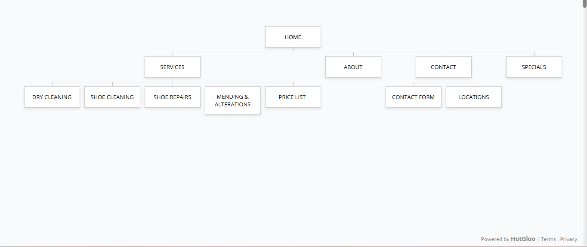

# Connoisseur-Cleaners-Website
# Student Information:
Naledi Lukhele- ST10519692
WEDE5020- MR.Malepe
# PROJECT OVERVIEW:
Connoisseur Cleaners is a dry cleaners that opened in 1980s, with factory in Birch acres and 4 other deport points. This projects involves designing and developing a functional website for the business to improve in its online presence and it accessible to potential clients. The website serves as an information platform where clients can view services like Dry Cleaning, Shoe cleaning, Shoe Repairs and Mending & Alterations, specials, a contact form, price list and locations can also be viewed. The target audience are students, working professionals, families and businesses who need regular dry-cleaning, lanudry and garment care services.
# WEBSITE GOALS AND OBJECTIVES:
This website aims to promote weekly specials and promotions and to attract customers. It also aims to provide clear information on services and pricing. It will also help customers access information and services anytime and anywhere. The success of the website will be measured by the interest in weekly promotions, the demand for services and foot traffic after posting new specials.
# KEY FUNCTIONALITY AND FEATURES
- Homepage
- Service Page with price list
- Specials Page
- About us Page
- Contact Page with locations
- Mobile-friendly
- Responsive navigation
# TIMELINE AND MILESTONES
- 11 Aug 2026: Proposal of Conniosseur Cleaners created
- 17 Aug 2026: Approved proposal and html created with home, Services, specials, About us Contact pages: completed
- 09 September 2026: Creation of css file and responsive layout: completed
- 16 September 2026: Creation of Github repository 
- 18 September 2026: Creation of sitemap and readme file
  # PART 1 DETAILS
  I was required to create two separate proposals for local community businesses and make website proposals. I chose a TashBless Pharmacy and Conniosseur Cleaners and created proposals for each and on the 11th August 2026, I presented my Pharmacy prosposal and it was not approved however I redeemed myself with the Conniosseur Cleaners proposal on the 17th of August. An HTML file for my website was created which included a home, services, about us, contact with locations pages
# SITEMAP
  
